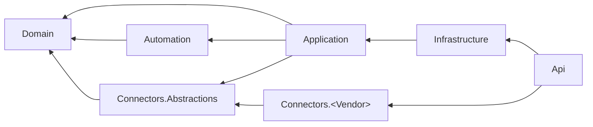
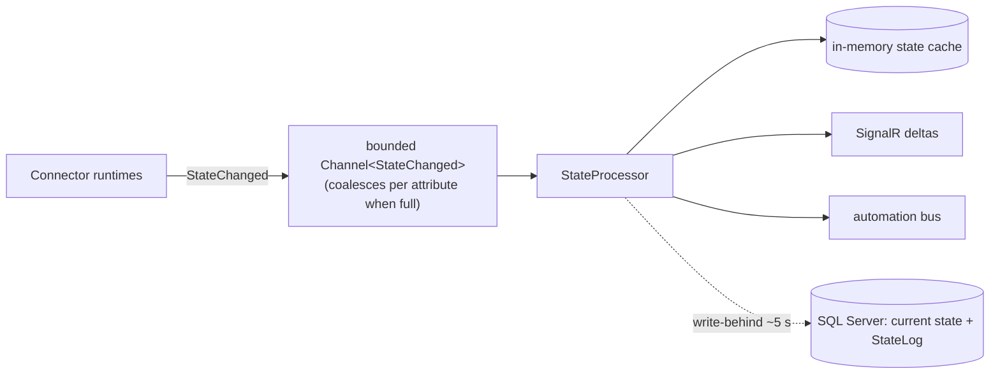

# ControlHome architecture

> **Living document.** It started as the Architecture section of the approved phased plan (2026-10-11) and is refined
> by the per-phase task plans in [`docs/plans/`](plans/). When a milestone changes a decision, update this file in the
> same PR. Decisions with real trade-offs also get an ADR in [`docs/adr/`](adr/README.md).
>
> Each section says the milestone where it lands (see [`roadmap.md`](roadmap.md)). Anything not yet built is still
> the agreed design, not a wish list.

**Contents:**
[1 Context](#1-context-and-constraints) ·
[2 Layout](#2-repository-layout-and-reference-graph) ·
[3 Devices](#3-capability-and-device-model) ·
[4 Connector SDK](#4-connector-sdk) ·
[5 Runtime](#5-runtime-pipeline) ·
[6 Storage](#6-storage-history-and-energy) ·
[7 Automation](#7-automation-engine) ·
[8 Safety](#8-safety-critical-commands-and-inbound-hooks) ·
[9 Auth and secrets](#9-auth-request-edge-and-secrets) ·
[10 API conventions](#10-api-conventions) ·
[11 Frontend](#11-frontend-one-design-source-enforced) ·
[12 Deployment](#12-deployment) ·
[13 CI/CD](#13-cicd-github-actions) ·
[14 Integrations](#14-integration-matrix) ·
[15 Guard rails](#15-cross-cutting-guard-rails) ·
[16 Testing](#16-testing-and-test-hooks)

---

## 1. Context and constraints

ControlHome is a **self-hosted home-control web app**: a dashboard plus automation for IoT devices from many vendors.

- It runs in Docker on the owner's Umbrel, **on the LAN only** (not SaaS). It has authentication and a first-run
  setup wizard. Household accounts have Admin / Member / Viewer roles. UI languages: **pt-BR and English**.
- **Hard constraints:** backend in .NET (C#), frontend in Vue.js, database Microsoft SQL Server.
- **Devices in scope:** Samsung/SmartThings, LG, Intelbras (Izy, cameras/NVR, intercom/locks, Twibi mesh, gate
  automation, non-AMT alarm/sensors), generic/DIY.
- **Integration approach:** native connectors per vendor plus generic MQTT. **No Home Assistant dependency.**
- **Floor plans:** each floor gets room polygons drawn on a snapping grid (optional traced background image); devices
  are dragged onto it and the map shows live state.
- **Hosting:** an Umbrel community app plus a plain compose file.

Stack choices that follow from research (Oct 2026):

| Decision | Reason |
|---|---|
| shadcn-vue + Reka UI + Tailwind 4 (all MIT) | PrimeVue 5 is now proprietary. |
| No MediatR, AutoMapper or FluentAssertions | Their recent versions are commercial. Plain services + DI, hand mapping, Shouldly. |
| TypeScript 6 (`~6.0.x`), not 7 | vue-tsc can't handle TS 7 yet. |
| Node 24 LTS | Vitest 5 and the API-client generators need Node ≥ 22. |
| Own scheduler on Cronos + SunCalcNet | Instead of Quartz 4. |
| Multi-arch app image, database kept external | SQL Server images are x64-only; Umbrel hosts can be arm64. |

The full rationale is in [ADR 0001](adr/0001-stack-and-architecture.md).

---

## 2. Repository layout and reference graph

*Lands: 0.1 (skeleton); projects marked "later" are created in the milestone that first needs them.*

```
ControlHome.slnx · global.json {sdk 10.0.302, rollForward latestFeature} · Directory.Build.props · Directory.Packages.props
.config/dotnet-tools.json (dotnet-ef 10.0.x) · .editorconfig · CLAUDE.md · docs/STATUS.md
src/ControlHome.Domain                   no deps: entities, CapabilityDefinition/ValueSchema, automation definition records
src/ControlHome.Connectors.Abstractions  → Domain: descriptor/flow/runtime/context contracts, ICameraStreamRegistry, helpers   (later)
src/ControlHome.Automation               → Domain only: engine + ports (IStateReader, ICommandDispatcher, ISceneRunner,       (later)
                                           INotifier, IAutomationStore, TimeProvider); no EF
src/ControlHome.Application              → Domain, Automation, Connectors.Abstractions: use-case services incl.
                                           DeviceCommandService; DTOs defined ONCE here; IControlHomeDb port (DbSets +
                                           SaveChanges); NO per-aggregate repository/UoW layers
src/ControlHome.Infrastructure           → Application: DbContext + migrations, StateProcessor, state cache,
                                           IntegrationSupervisor, scheduler host, port implementations, rollup/retention/export jobs
src/ControlHome.Connectors.<Vendor>      → Abstractions only (created in the milestone that implements it)
src/ControlHome.Api                      → Infrastructure + connectors (static AddConnector<T>(), no plugin loading)
tests/  Domain · Automation · Connectors (WireMock.Net + upstream-derived fixtures) · Api.IntegrationTests · Architecture
web/    npm workspaces (.nvmrc 24.21.0, .npmrc engine-strict)
  packages/ui          @controlhome/ui, source-only (exports src; vue/reka-ui are peers); components.json lives here
  packages/api-client  generated by @hey-api/openapi-ts from the committed openapi.json (REST + SignalR DTOs)
  apps/web             Vue 3.5 app; src/features/<f>/{routes.ts, locales/*.json, …} auto-registered via import.meta.glob
  tests/e2e            Playwright specs + screenshot runner
deploy/   Dockerfile · docker-compose.yml (prod, host net) · docker-compose.dev.yml (bridge, ports, bundled-db) · .env.example · umbrel/ (template)
scripts/  setup-dev · dev · reset-dev-db · check-secrets (pre-commit) · tools/scrub-fixtures
docs/     architecture.md · adr/ · roadmap.md · development.md · connectors/<vendor>.md · connectors/LIVE-VALIDATION.md · plans/
```



Rules (an arrow means "may reference"):

- `Domain` references nothing (no EF Core, no ASP.NET Core).
- `Application` never references `Infrastructure`, `Api` or the ASP.NET Core web stack: no `Microsoft.AspNetCore.App`
  framework reference and no `Microsoft.AspNetCore.Http`/`.Mvc`/`.Builder`/`.Routing`/`.Hosting`/`.Authentication`
  types. It may use ASP.NET Core Identity's model (`IdentityUser`, `UserManager`, namespace
  `Microsoft.AspNetCore.Identity`, from the `Microsoft.Extensions.Identity.*` packages). `Infrastructure` never
  references `Api`.
- `Automation` references `Domain` only — no EF.
- `Connectors.<Vendor>` references `Connectors.Abstractions` only; connectors are registered statically by the Api
  (`AddConnector<T>()`), never loaded as plugins.
- Tests may reference anything.

An architecture test project (`tests/ControlHome.Architecture.Tests`, NetArchTest) checks these rules in CI. Each
`src` project exposes a `public sealed class AssemblyMarker;` so the tests can load it.

---

## 3. Capability and device model

*Lands: Home in 0.2; floors/rooms in 1.1; devices and capabilities in 1.2.*

### Home model

- **`Home`** is a single row (Id = 1): name, IANA time zone (default `America/Sao_Paulo`), latitude/longitude,
  locale (`pt-BR` | `en`), currency (BRL), tariff and `SetupCompletedAt`. The tariff starts as `flat` with a price per
  kWh (0.2); Tarifa Branca and bandeira surcharges arrive with the energy dashboard (5.1).
- **`Floor`** (1.1) has a level, a size in cm (the SVG viewBox, origin top-left, default 2000 × 1500), an editor grid,
  and an optional background (JSON: a `StoredFile` id, opacity, offset in cm and `CmPerPx`, which the editor's
  two-point calibration computes). A `rowversion` is the optimistic-concurrency token of the floor *and* its layout:
  every change sends the version it edited, and a stale one gets 409 `floors.concurrency` (a layout save always
  touches the floor row, so two admins saving at once cannot both win).
- **`Room`** (1.1) has a polygon (EF complex collection of `PointCm`, one `json` column), a color token
  (`room-1`…`room-8`), an icon key and a sort order. `PUT /api/floors/{id}/layout` replaces a floor's rooms in one
  save. Server-side geometry (`Domain/Geometry/PolygonMath`, mirrored by the editor's `geometry.ts`): at least 3
  distinct points, simple (no crossing or touching edges), inside the floor, at least 1 cm² — violations are field
  errors `rooms[i].polygon` with codes `geometry.*`.
- **`StoredFile`** (1.1) keeps uploads in the database (`varbinary(max)`, SHA-256, size in px): images are only ever
  stored re-encoded (see the floor-plan editor in §11) and served immutable (`Cache-Control: private, max-age=31536000,
  immutable`, `nosniff`).

### Device hierarchy

```
Device ─► Endpoint ─► EndpointCapability ─► Attribute (int AttributeId)
```

- **`Device`**: integration, `ExternalId`, manufacturer/model/firmware, Connections (MAC, serial, Matter id),
  `ViaDeviceId` parent, availability, `Orphaned` flag.
- **`Endpoint`**: key, name, room, icon, hidden and favorite overrides.
- **`EndpointCapability`**: per-instance constraints JSON — enum subset, ranges (including mode-dependent ones), a gate
  attribute such as `remoteControlEnabled`.
- **`Attribute`** has an **int `AttributeId`**, used by every state, history and energy table.

### Capability definitions

- `CapabilityDefinition` is **defined in code** and served at `/api/capabilities`.
  - Fields: id, version, `attributes[]`, `commands[]`.
  - Each **attribute** has a key, a ValueSchema, a canonical unit, a stateClass (`measurement`, `total`,
    `total_increasing` or `none`), a category (`primary` or `diagnostic`) and a `recorded` flag.
  - Each **command** has argument ValueSchemas, a confirmation mode (`AckIsFinal` or `AwaitState(timeout)`) and a
    **`safetyCritical`** flag.
- **Catalogue**
  - Actuators and controls: switch, level, color/colorTemp, thermostat/AC, lock, doorOpener, gate/cover, alarmPanel,
    mediaPlayer, button/event.
  - Sensors: power (W), energy (Wh), temperature, humidity, contact, motion, occupancy, smoke, waterLeak, airQuality,
    battery, presence.
  - Other: camera, applianceCycle.
  - A **generic** capability reuses ValueSchema for any vendor property that has no mapping.
- **ValueSchema types:** bool, number or int (min, max, step, scale, unit), enum, string, flags/bitmap, json
  (read-only), momentary.
- **Units:** connectors convert values to canonical units (W, Wh, °C, %) before reporting them.

### Endpoint or child device?

- One external id with sub-reports becomes **several endpoints**: Shelly channels, Tuya `switch_1..n`, SmartThings
  components, LG fridge locations.
- Separate external ids become **child devices**: NVR channels, LG `WASHTOWER_WASHER`/`_DRYER`, Zigbee2MQTT devices.

### Placement

`Placement(EndpointId | DeviceId, FloorId, X, Y in cm)`. When a device is dropped onto the plan, its room is assigned by
a point-in-polygon test.

---

## 4. Connector SDK

*Lands: 1.2 (SDK + Simulated connector), 1.3 (integrations flow and merge rules).*

- **`IConnectorDescriptor`**: key, name, icon, an integration config schema, a per-device config schema (for per-device
  secrets such as a Tuya `local_key`, webOS client-key or camera credentials), and **Flows**.
- **Flows** are a step machine:
  - Steps: `Form` | `ExternalUrl + PasteBack` | `Progress` (wait for an action on the device, with a timeout) |
    `Choose` | `Done(config, secrets)`.
  - Flows cover setup, reauth/replace-token (devices are kept), pairing, and permit-join.
- **`IConnectorRuntime`**, one per integration:
  - `RunAsync(ctx, ct)`.
  - `ExecuteAsync(DeviceCommandBatch)` returns `Accepted | Completed | Rejected(reason)`.
  - `RefreshAsync(device)`.
- **`IConnectorContext`**:
  - `ReportState(attr, value, observedAtUtc?)`, `ReportEvent`, `ReportAvailability`.
  - `UpsertDevice` / `RemoveDevice` for connectors that push their own inventory.
  - `SetStatus(Ok | Connecting | Degraded | NeedsReauth | PlanRequired | QuotaExceeded | Error)`.
  - A per-device secret store, and quota counters persisted in the DB.
- **Merge rules**
  - Devices match on `(IntegrationId, ExternalId)`; `ExternalId` is a stable vendor id, **never an IP**.
  - Vendor fields update; user fields (name, room, icon, placement) are **never overwritten**.
  - A device that disappears becomes **Orphaned** and the automations that use it are flagged. Nothing is deleted
    automatically.
  - "Replace device" moves history and automations to the new device.
  - Likely duplicates across integrations are flagged at import.
- **Commands**
  - Each CommandDefinition sets its own timeout; defaults are about 5 s local, 30 s cloud, 90 s for a TV wake.
  - Rapid writes to the same attribute are coalesced (about 300 ms, last one wins).
  - A connector can batch commands.
- **Availability:** while a runtime is down, the supervisor marks its devices Unknown. Each device class has a last-seen
  timeout so sleepy sensors aren't marked offline, and offline notifications are debounced by 2 min.
- **Shared helpers:** HttpClient with Microsoft.Extensions.Http.Resilience, token buckets, an adaptive poller with
  hot-poll after a command, and error classification (401 → `NeedsReauth`, 402 or a plan error → `PlanRequired`,
  429 → backoff).

---

## 5. Runtime pipeline

*Lands: 1.2.*



The `StateProcessor`, in order:

1. Dedupes and drops out-of-order updates.
2. Updates the in-memory cache.
3. Sends SignalR deltas immediately.
4. Feeds the automation bus.
5. **Write-behind:** flushes current state plus StateLog about every 5 s.

- **DB outage:** StateLog rows are buffered and then dropped (never current state), and a "history paused" banner
  appears. Control and automations keep working.
- **Startup and reconnect:** the cache is hydrated from the DB, with values flagged `restored` until a connector
  confirms them. Clients resync over REST when they reconnect.
- **Single active runtime:** the app holds `sp_getapplock('ControlHome.Runtime', Exclusive, Session)` on a dedicated
  connection. A second process becomes a **read-only standby**: no connectors, no scheduler, and a banner. This
  protects SmartThings' single-use refresh tokens and prevents automations from firing twice.

---

## 6. Storage: history and energy

*Lands: schema rules in 0.2; StateLog in 1.2; rollups, retention and EnergyHourly in 1.4.*

- **`StateLog`**: `(AttributeId int, TsUtc datetime2(3), Num float NULL, Str nvarchar(255) NULL)`.
  - Clustered index on `(TsUtc, AttributeId)`; nonclustered on `(AttributeId, TsUtc) INCLUDE (Num, Str)`.
  - PAGE compression.
  - Only `recorded` attributes are stored. Diagnostics such as link quality and RSSI are off by default.
- **`StatShortTerm` (5-minute) and `StatHourly`**:
  - Primary key `(AttributeId, BucketStartUtc)`.
  - Measurements store a time-weighted mean plus min and max.
  - Counters store `Sum` and `LastCounter`, with reset detection.
  - Rollups resume from a `RollupProgress` watermark and are idempotent (`MERGE`).
  - Purges only delete rows older than **both** the retention limit and the rollup watermark, using `DELETE TOP (5000)`
    loops.
- **`EnergyHourly(EndpointId, HourStartUtc, Wh, Source = counter|delta|vendorWindow|integratedPower, Estimated)`** is
  the **single source for every energy view** and is in place from Phase 1.
  - Vendor windows are spread across hours. LG daily-only data is flagged "not hourly".
  - Power-only devices are integrated with the trapezoid rule and flagged estimated.
  - Each endpoint has exactly one selected source, so energy is never counted twice.
- **Retention defaults** (configurable): StateLog and 5-minute stats 10 days, DeviceEvent 30 days, AutomationRun 30 days
  or the last 200, Notification 90 days, AuditLog 1 year, hourly stats forever.
- **Automation and scene definitions**
  - `Automation.Definition` is a single `json` column holding polymorphic System.Text.Json (`[JsonPolymorphic]`,
    discriminator `type`) with a `schemaVersion`. Golden-file tests cover the upgrade functions.
  - `AutomationReference(AutomationId, DeviceId, AttributeId)` is rebuilt on every save to power "where used".
  - One FluentValidation validator is shared by the API and the engine.
  - Scenes and dashboards use the same pattern. EF `.ToJson()` is used only for flat shapes (tariff, calibration,
    polygon).
- **Schema**
  - **SQL Server 2025 is required.** `UseCompatibilityLevel(170)` is set unconditionally, so the native `json` type is
    always used.
  - After `Build()`, a startup check verifies `SERVERPROPERTY('ProductMajorVersion') >= 17` (else
    `sql.version_unsupported`) and compatibility level 170. A database the app creates itself gets
    `RECOVERY SIMPLE` and `COMPATIBILITY_LEVEL = 170`.
  - App tables live in schema `ch`, ASP.NET Core Identity tables in schema `auth`. Times are stored as UTC
    (`datetime2` / `DateTimeOffset`).
  - **Nothing before `builder.Build()` may open a DB or network connection** (build-time OpenAPI generation runs
    `Program.cs`).
- **Database readiness** (0.2): a `DatabaseInitializer` background service retries the connection with backoff for up
  to `Database:StartupTimeout` (default 10 min), migrates when `Database:AutoMigrate` (default true) and seeds roles.
  State is `NotConfigured | Connecting | Migrating | Ready | Failed`. Until it is `Ready`, `/api/*` (except
  `/api/setup/status`) answers **503 `db.unavailable`** instead of crashing, `/health/ready` is unhealthy, and the app
  becomes ready on its own when the database appears.

---

## 7. Automation engine

*Home Assistant semantics, built in-house. Lands: MVP in 3.1, full engine in 3.2.*

- **MVP (3.1)**
  - Triggers: time, cron, sun (rise/set ± offset), device state (from/to and numeric thresholds, with a `for`
    duration), manual.
  - Conditions: an AND/OR/NOT tree over state, time window and weekday.
  - Actions: device command, scene, delay, notify.
  - Run modes: `single` and `restart`. Traces are persisted.
- **Full engine (3.2)** adds: wait-for with timeout, if/choose, the `queued` and `parallel` run modes, local
  webhook / startup / presence / home-mode / connector-event triggers, and set home mode / enable or run an automation.
- **Semantics**
  - Evaluation runs in a single-reader loop; runs are tasks governed by the run mode.
  - Transitions to or from `unknown` / `unavailable` / `restored` never match a trigger unless it explicitly asks for
    them.
  - On restart: in-flight runs are marked "interrupted", `for` timers re-arm from the persisted `LastChangedUtc`, and
    missed time triggers are **not** replayed.
  - Trigger ids and `{{trigger.*}}` placeholders are available (a tiny syntax, not Jinja).
  - Every command carries a Context (origin, automationId, runId, depth).
  - **Loop protection:** runs deeper than 5 are refused, and an automation that runs more than 30 times a minute is
    auto-disabled with a notification.
  - Each action has `continue_on_error`.
  - Broken references disable the automation and show the reason.
  - An injectable `TimeProvider` lets tests time-travel.

---

## 8. Safety-critical commands and inbound hooks

*Lands: 1.2, for every connector including Simulated.*

- **Principals:** `User(role)`, `System(automation or scene, runId)`, `Kiosk(token)`. `DeviceCommandService` authorizes
  and audits **every** command.
- **Safety-critical commands:** `lock.unlock`, `doorOpener.open`, `cover.open` (gate or garage), `alarmPanel.disarm`.
  - From the UI they need a **step-up per-user PIN**, valid for 60 s. Five failures in 15 min lock that user out of
    these commands.
  - Viewer and Kiosk can never send them.
  - Automations and scenes can send them only if an Admin sets `allowSafetyCritical` (audited), and **never when the
    trigger is unauthenticated**.
  - Fail-safe directions (lock, close) are never restricted.
  - Delivery is **at-most-once**: no retry or hedging, an idempotency key, and the UI control is disabled while the
    command is pending.
  - A toggle relay that has no contact sensor shows "state unknown" and asks for confirmation.
- **Inbound hooks:** `/api/hooks/{128-bit id}`, rotatable and masked in logs.
  - Optional source-IP allowlist, a 64 KB body limit and 30 requests/min.
  - Hooks only publish to the trigger bus and are marked `Unauthenticated`. They never call `DeviceCommandService`.
  - The syslog listener (UDP 5514) is off by default and only accepts known device IPs.

---

## 9. Auth, request edge and secrets

*Lands: 0.2 (identity, edge, setup, audit, Data Protection); log redaction with the first secret-bearing connector
(1.2); HTTPS listener in 2.1.*

### Identity

- ASP.NET Core Identity (`AppUser : IdentityUser<Guid>` + DisplayName, Locale, Theme, IsDisabled, timestamps,
  ConsecutiveLockouts). Custom `login` / `logout` / `me` endpoints, **not** `MapIdentityApi`.
- Cookie `ControlHome.Session`: HttpOnly, `SameSite=Strict`, Secure on HTTPS (`SameAsRequest`), 30-day sliding.
  Unauthenticated API calls get 401 / 403 ProblemDetails, never a redirect.
- The security stamp is validated **every minute**. Disabling a user or changing their role updates the stamp and
  aborts their SignalR connections.
- Passwords: at least 10 characters, no composition rules.
- Authorization: fallback policy = authenticated; policies `Admin` (Admin), `Member` (Admin | Member), `Viewer` (any
  role). `Admin` also checks the database on every request (the user exists, is enabled, is in the Admin role and the
  session's security stamp is current), so a demoted or disabled admin loses Admin access at once rather than at the next
  stamp check; user administration re-checks the caller again inside its lock (403 `auth.forbidden`).

### Roles

Admin (configuration and users) · Member (control, scenes, automations) · Viewer (read-only). The last active Admin
can't be removed, demoted or disabled (`users.last_admin`), and an admin can't delete themselves.

### Cross-origin protection (global middleware)

- `UseControlHomeRequestEdge()` (`Api/Security`) runs right after the exception handler and before static files and
  routing: forwarded headers → security headers → network allowlist → host name check → origin checks.
- Every mutation (any method other than GET/HEAD/OPTIONS) **and** every WebSocket/SignalR upgrade (HTTP/1.1
  `Upgrade: websocket`, or HTTP/2 extended CONNECT) must carry an `Origin` equal to the app's own origin
  (`{scheme}://{host}` after forwarded headers; host case-insensitive, default ports implied, exactly one serialized
  origin with no path); a missing, `null` or foreign Origin gets **403 `request.cross_origin`**.
- Non-WebSocket mutations also need the header **`X-ControlHome: 1`** (403 `request.missing_header`). `/api/hooks/*`
  is exempt.
- Hubs are server → client only. **No CORS policy is ever registered.**
- Every response (errors and exception responses included) carries `Content-Security-Policy: default-src 'self';
  img-src 'self' data: blob:; media-src 'self' blob:; connect-src 'self'; style-src 'self' 'unsafe-inline'; script-src
  'self'; frame-ancestors 'none'; object-src 'none'; base-uri 'self'`, `X-Content-Type-Options: nosniff`,
  `Referrer-Policy: same-origin` and `X-Frame-Options: DENY`. They are added when the response starts unless an
  endpoint set that header itself. In Development only, `/scalar*` gets a CSP that also allows Scalar's inline
  bootstrap script and its fonts from `fonts.scalar.com`.

### Network edge

- Forwarded headers (`X-Forwarded-For`, `-Proto`, `-Host`; one hop) are applied only from trusted proxies. With
  `Network:TrustedProxyNetworks` empty (default) that is the framework default, loopback proxies only; when set (the
  app_proxy subnet on Umbrel), exactly those networks replace it. Behind a proxy that is not trusted, every client looks
  like the proxy.
- `Network:AllowedClientNetworks` defaults to loopback, RFC 1918, CGNAT, ULA and link-local (`127.0.0.0/8, ::1/128,
  10.0.0.0/8, 172.16.0.0/12, 192.168.0.0/16, 100.64.0.0/10, fc00::/7, fe80::/10`); anything else gets **403
  `request.network_denied`** and an audit entry (`security.network_denied`). Loopback is always allowed (the container
  healthcheck), and a request without a remote address (Unix socket, TestServer) passes.
- **Host names (DNS rebinding).** The same-origin check compares `Origin` with the request's own `Host`, which a
  rebinding page controls (its name re-pointed at the app's LAN address, loaded in a household member's browser), and its
  connection comes from an allowed LAN address. So every request, whatever the method or path (GET responses would be
  readable too, `/api/hooks/*` included), must name the app by a host it answers to (after forwarded headers): an IP
  literal, `localhost`, a single-label name (`umbrel`), a name under `.localhost`, `.local`, `.home.arpa`, `.lan` or
  `.internal`, or an entry of `Network:AllowedHostNames` (exact names or `*.suffix`, e.g. a Tailscale MagicDNS or custom
  DNS name). Anything else, or no `Host`, gets **403 `request.host_denied`** and an audit entry (`security.host_denied`).
- The lists are a comma-separated string (`Network__AllowedClientNetworks=192.168.1.0/24, fd00::/8` replaces the whole
  list) or an array; network entries are addresses or CIDR networks (canonical IPv4 only), host name entries are DNS
  names or `*.suffix` (no scheme, no port). An invalid entry stops startup with an error naming the setting and the entry.
- Denied requests are logged and audited **at most once per source per 10 minutes** (a source is an IPv4 address or an
  IPv6 /64; network and host denials are throttled separately), with at most 1024 sources tracked per window, so a flood
  cannot fill the audit log. While the database is not ready the denial is only logged.

### Login protection

- Rate limits per client (`login`: 10/min per IPv4 address or IPv6 /64), one budget shared by sign-in, password change
  and the reset-token redemption.
- Lockout starts at 5 failures for 5 min and backs off (`5 min × 2^ConsecutiveLockouts`) up to 1 h; it is never
  permanent and resets on success. Responses: 401 `auth.invalid_credentials`, 423 `auth.locked_out`
  (`retryAfterSeconds`), 403 `auth.disabled`.
- Every check of a password runs under the user's sign-in lock (`ControlHome.Login.{id}`) and counts towards the same
  lockout: a wrong current password on `POST /api/auth/me/password` counts like a failed sign-in (400
  `auth.password_incorrect`, audited `auth.password.change_failed`; 423 while locked out), so a session cannot be used to
  guess the password.
- Unknown user names are counted the same way (in memory, at most 1024 names): they too get 423 after 5 failures, so
  responses never reveal which names exist. A client that disconnects mid-check is still counted and audited.

### Setup lifecycle

- Setup is gated by the one-way `Home.SetupCompletedAt` flag and runs in **one transaction under an app lock**
  (`sp_getapplock('ControlHome.Setup', 'Exclusive', 'Transaction')`). A second or concurrent completion gets
  409 `setup.already_completed` — exactly one admin is ever created.
- **Setup code:** 12 Crockford base32 characters from `RandomNumberGenerator` (shown as `XXXX-XXXX-XXXX`), compared in
  constant time after normalization, regenerated on every process start and rotated after 20 failed attempts. It is
  logged and written to `<data>/setup-code.txt` only while setup is incomplete (deleted on completion; afterwards no
  code is accepted, rotated or announced), and can be overridden with `Setup__Code` (used by Umbrel `$APP_PASSWORD` and
  E2E; at least 12 characters, else startup fails). A configured code is **never rotated** (the owner reads it from their
  own configuration; rotating it would let anyone on the LAN block setup). Wrong attempts are rate-limited (`setup`:
  5 per 10 min per IPv4 address or IPv6 /64) and return 400 `setup.invalid_code`.
- The wizard covers: admin account, home name, language, time zone, location, currency and tariff, plus an optional
  "Load demo home". When no database is configured yet, it starts with a database step (see
  [Deployment](#12-deployment)).
- **Recovery:** `docker exec … reset-admin <user>` prints a one-time code valid for 15 min; the action is audited.

### Audit log

Setup, logins, lockouts, password/PIN/role changes, secret updates (field names only), and commands.

### Secrets

- **Data Protection** with `SetApplicationName("ControlHome")`. The key ring lives in the DB, **protected with a
  certificate** generated on first run at `/data/keys/dataprotection.pfx` (RSA 3072, mode 0600), so a DB leak alone
  exposes nothing.
- Secret API fields are **write-only**.
- Exports include secrets only when re-encrypted with a passphrase.
- **Log redaction:** a `KnownSecretsRedactor` covers every Serilog event, HttpClient/YARP log levels are lowered, and
  request logs use route templates. A canary test checks that no secret appears in logs, responses or hub payloads.
  Never log connection strings or tokens.
- **HTTPS:** an optional HTTPS listener (the user's certificate, or self-signed on first run) lands in milestone 2.1.
  Passkeys, TOTP and web push come later, on HTTPS.

---

## 10. API conventions

*Lands: 0.1–0.2. The short version lives in [`CLAUDE.md`](../CLAUDE.md).*

- ASP.NET Core 10 **minimal APIs**; one static class per feature (`Features/<Feature>/<Feature>Endpoints.cs` with
  `Map<Feature>Endpoints`), services registered per feature (`services.Add<Feature>()`), so shared files only get
  one-line additions.
- Endpoints return `TypedResults`; validation via FluentValidation (`ValidationFilter<T>`).
- DTOs are C# `record`s defined **once** in `ControlHome.Application`; mapping is by hand.
- Application services use the `IControlHomeDb` port (DbSets + SaveChanges) directly — no per-aggregate repositories.
- **Errors** are RFC 7807 ProblemDetails with an extension **`code`** (stable, dotted: `auth.invalid_credentials`,
  `users.last_admin`, `db.unavailable`, `validation.failed` with an `errors` dictionary, …) and `traceId`. Exception
  text never leaves Development. The SPA maps `code` → i18n key `errors.<code>`.
- **OpenAPI 3.1** is generated at build time into `web/packages/api-client/openapi.json` (committed); the TypeScript
  client is generated from it (`npm run gen:api`) and CI fails on drift. Scalar UI only in Development.
- **Time:** inject `TimeProvider`; never `DateTime.Now`/`UtcNow` in logic.
- **Logging:** Serilog structured templates; console + rolling file `{dataPath}/logs/controlhome-.log` (daily, 14
  files); no secrets, no PII beyond user names.
- **Health:** `GET /health/live` (process up) and `GET /health/ready` (database `Ready`), both anonymous.
- **SPA hosting:** the API serves the built SPA from the same origin (`ControlHome:SpaPath` or `wwwroot`), falls back
  to `index.html` for any non-`/api`, non-`/hubs`, non-`/health` path, and returns a 404 ProblemDetails (never
  `index.html`) for unknown `/api/*` paths, or 405 `request.method_not_allowed` with an `Allow` header when the path
  exists for other methods.

---

## 11. Frontend: one design source, enforced

*Lands: tokens + 3 primitives in 0.1; shell, theme and i18n in 0.3; floor-plan editor in 1.1; charts in 1.4.*

- **Single theme source**
  - `web/packages/ui/src/styles/tokens.css` holds the OKLCH tokens for `:root` and `.dark`, including semantic device
    colors (`--state-on/off/offline/warn/energy/danger/info`, each with `-foreground`). Calm slate/neutral surfaces,
    primary teal/cyan, energy amber, danger red.
  - `theme.css` starts with `@theme inline { --color-*: initial; … }`, which removes Tailwind's default palette, and
    then maps only the semantic tokens (`bg-primary`, `text-muted-foreground`, `bg-state-on`, …).
  - `apps/web` imports `@controlhome/ui/styles.css` and adds `@source` for `packages/ui`.
- **Lint and CI checks**
  - ESLint Tailwind v4 rules (`eslint-plugin-better-tailwindcss`) reject unknown classes (`no-unknown-classes`, so
    `text-red-500` fails) and arbitrary color values such as `bg-[#fff]` (`no-restricted-classes`).
  - `npm run check:colors` rejects hex/rgb/hsl/oklch/oklab/color-mix literals outside `tokens.css`, including SVG
    fill/stroke and inline styles.
- **Shared component sources**
  - Primitives come only from `@controlhome/ui` (shadcn-vue components in `packages/ui/src/components/ui`); pages never
    re-implement a primitive.
  - Charts and canvases get colors only from `useThemeTokens()` / `useChartTheme()`.
  - One `<SchemaForm>` / `<SchemaField>` renders every schema-driven UI: integration config, device config, flow steps,
    generic capability controls, and scene and action arguments.
  - One **capability-control registry** (capabilityId → component, falling back to `SchemaField`) is used by
    DeviceTile, device detail, the floor-plan popover, the scene editor and the automation editor.
- **App structure:** features are folders `apps/web/src/features/<feature>/` (`routes.ts`, optional `nav.ts`,
  `locales/en.json`, `locales/pt-BR.json`, pages, components) auto-registered via `import.meta.glob`. API calls only
  through the generated `@controlhome/api-client`, which sends `X-ControlHome: 1` and same-origin credentials.
- **App libraries:** Vue 3.5 (`<script setup lang="ts">`, Composition API), Vite 8, TS ~6.0, Pinia 4 (setup stores),
  Vue Router 5, VueUse, vue-i18n 11 (pt-BR and en; **a missing key throws in tests**), @microsoft/signalr, ECharts
  through vue-echarts, @lucide/vue plus mdi device icons.
- **`/dev/ui-kit`** (Admin only) renders every token and component for visual review.
- **Floor-plan editor (SVG)** (1.1: `components/floorplan/*` shared, `features/floors/*`)
  - One `FloorPlanCanvas` for view and edit: viewBox in cm, pan (drag, middle mouse, one finger), zoom (wheel, pinch,
    buttons), fit; rooms filled with their room token at reduced opacity (stronger on the dark theme) and outlined in
    the solid token with screen-pixel strokes, labelled with name and area sized to the room on screen; the selected
    room gets a focus-colored ring outside its outline; dashboard previews use it non-interactive (`FloorPreview`).
  - The traced background image is a tracing aid: only the editor draws it; the view shows it on request ("Show
    original plan", at most 15 % opacity) and previews never do.
  - Snapping (12 screen px) to the grid, own vertices, and other rooms' vertices and edges; closest wins, Alt disables.
  - Tools: Select (move room, drag corner, wall midpoint or double-click adds a corner, Delete with an undo toast),
    Draw room (clicks or a dragged rectangle; on touch screens Finish / Undo corner / Cancel buttons), plus the
    background image's Calibrate and Move in the panel's Image tab. Rectangular rooms also take a typed width × depth
    and position. Pure tool functions in `features/floors/editor/tools/*`.
  - The editor is a focused task: on phones the bottom tab bar steps aside and the panel is a sheet that peeks out
    below the plan.
  - Polygon validation (`geometry.ts` mirrors `PolygonMath` and `RoomPolygonRules` with the same tests) and
    undo/redo (`useCommandStack`, immutable snapshots) on a draft, which is saved or cancelled explicitly (leave guard).
    A save is `PUT /api/floors/{id}` (properties, background) and/or `PUT …/layout`, ordered so rooms fit both the old
    and the new size; 409 `floors.concurrency` offers to reload.
  - Two-point calibration.
  - Uploads: PNG/JPEG/WebP only, checked by magic bytes, max 10 MB and 40 megapixels (checked before decoding),
    re-encoded server-side with SkiaSharp 3 (`SkiaSharp.NativeAssets.Linux.NoDependencies` in the chiseled image) to
    WebP quality 85, ≤ 4096 px, EXIF orientation applied and all metadata dropped. **No SVG.**
  - View mode shows live state and a tap-to-control popover.

---

## 12. Deployment

*Lands: 0.4 (image, compose, pre-DB setup, release); 1.5 (Umbrel template).*

- **Image:** `ghcr.io/ricardozambon/controlhome`, multi-arch (`linux/amd64`, `linux/arm64`).
  - The `node:24` and `sdk:10.0` build stages use `--platform=$BUILDPLATFORM` and cross-compile with
    `dotnet publish -a $TARGETARCH` (no QEMU).
  - The runtime image is `aspnet:10.0-noble-chiseled-extra`: non-root, writes only to `/data` and `/tmp`, works under
    any UID.
  - Every `FROM` is pinned by digest. The healthcheck runs `--healthcheck` in exec form (GET `/health/live`, 2 s).
  - Ports: container `8711` (`ASPNETCORE_HTTP_PORTS`); in development the API uses 5080 and Vite 5173.
  - Data path `/data` (`ControlHome:DataPath`): keys, logs, setup code, uploads, `config/`, backups.
- **Database connection**
  - The connection string comes from env `ConnectionStrings__ControlHome`, then from `/data/config/database.json`
    (`setup/status` reports `databaseSource`: `environment`, `file` or `none`). The file holds the string encrypted
    with a bootstrap Data Protection key ring (`/data/keys/bootstrap`, application name `ControlHome.Bootstrap`)
    protected by the same certificate as the main key ring; it is written atomically, owner-only.
  - If neither is present, the app starts in **pre-DB setup mode**: the wizard's Database step (after the setup code)
    asks for host, port, DB, login, password and "trust server certificate"; `POST /api/setup/database` (setup code,
    rate limit `setup`, only while nothing is configured) tests the connection (always TLS) and saves it, and the
    initializer starts without a restart. Errors never echo the password or the connection string.
  - The app creates the DB if the login is allowed to (any name the operator chose; it never drops a database);
    otherwise it shows the T-SQL to run (`db.create_denied`: the DB plus a `ControlHome_App` login owning only it).
  - Inside containers, address the DB by IP (`127.0.0.1:1433` on Umbrel), never `*.local`.
  - At startup the app retries the DB for up to 10 min, showing a "waiting for database" page; after that the state
    stays `Failed` and the whole initialization is retried every 60 s, so a late database recovers without a restart.
- **DB operations**
  - On a DB the app created: recovery model SIMPLE and fixed autogrowth.
  - Migrations: refuse to downgrade, write a pre-migration config export, and `Database:AutoMigrate=false` together
    with `--migrate` allows manual runs.
  - The app never issues `BACKUP` or `RESTORE`.
  - Production should use a `ControlHome_App` login that is `db_owner` of `ControlHome` only. The docs give the T-SQL.
- **Compose:** production compose uses `network_mode: host` (needed for discovery, Wake-on-LAN and device push
  events — Umbrel's own Home Assistant app does the same) with `cap_drop: [ALL]` (`NET_RAW` only if ARP presence is
  enabled), `no-new-privileges`, `read_only` and tmpfs `/tmp`. All ports are ≥ 1024 and configurable, and the app
  checks for port conflicts at startup.
- **Optional profiles**
  - `mqtt`: Mosquitto with no anonymous access, a generated password and ACLs.
  - `cameras`: go2rtc. Its API listens on 127.0.0.1 with random credentials and `local_auth`; the RTSP server is
    disabled; `exec.allow_paths` is empty and modules are limited. Streams are registered at runtime, and the backend
    proxies only `/api/cameras/{id}/{ws|webrtc|snapshot}` behind our auth.
  - `matter`: matterjs-server on 127.0.0.1.
  - `bundled-db`: SQL Server 2025 Express (x64), bound to `127.0.0.1:1433`.
- **Dev compose:** `docker-compose.dev.yml` overrides to a bridge network, published ports (`8080:8711`), local build
  and `bundled-db` with its own `ControlHome_Compose` database.
- **Umbrel**
  - On Umbrel, reuse its Mosquitto, Zigbee2MQTT and SQL Server through their host ports.
  - Umbrel packaging lives in a separate public `controlhome-umbrel-store` repo (created by the owner): app_proxy
    follows Umbrel's home-assistant app pattern; `PROXY_AUTH_ADD=false`, `user: 1000:1000`,
    `${APP_DATA_DIR}/data:/data`, `Setup__Code=${APP_PASSWORD}` with `deterministicPassword: true`; the port is chosen
    so it doesn't clash with existing umbrel-apps.
  - `release.yml` opens a digest-bump PR on that store repo.

---

## 13. CI/CD (GitHub Actions)

*Lands: `ci.yml` (backend, frontend, secrets) in 0.1; API-client drift in 0.2; E2E, release, CodeQL and Dependabot in
0.4.*

- **`ci.yml`** (pull requests and pushes to `main`)
  - **Backend:** `dotnet tool restore` → `dotnet restore` → `dotnet build -warnaserror -c Release` → `dotnet test`
    (unit, architecture, integration with Testcontainers SQL Server 2025 at a pinned CU). Later: EF
    `has-pending-model-changes`, and a flag on migrations that drop tables or columns.
  - **Frontend:** `npm ci` → lint → vue-tsc typecheck → Vitest → raw-color check → build; API-client drift (build, gen,
    `git diff --exit-code`).
  - **Integration (0.4):** Playwright E2E against the prod compose plus `bundled-db` (including a database that starts
    late and DB setup from the UI), with screenshot artifacts.
  - **Checks:** gitleaks over the full history (`.gitleaks.toml`), and docker build (amd64) from 0.4.
- **`release.yml`:** on `v*` tags, plus `edge` on `main`. Builds amd64 + arm64, adds an SBOM and provenance
  attestation, pushes to GHCR, then verifies an anonymous pull.
- **`codeql.yml`** is enabled (C# build-mode none, JavaScript/TypeScript).
- **Dependabot:** NuGet, npm, GitHub Actions and Docker; 7-day cooldown, grouped minor/patch updates, at most 2 open
  PRs. Only green patch/minor PRs are merged.
- **Workflow hygiene:** every workflow declares `permissions:` explicitly (`contents: read` by default; release gets
  `packages` / `id-token` / `attestations: write`), uses `persist-credentials: false`, never `pull_request_target`, and
  pins every action by commit SHA (with the version in a comment). Container images used in CI are pinned by tag and
  digest.
- **Locally:** the pre-commit hook (`.githooks/pre-commit` → `scripts/check-secrets.sh`) blocks staged values that
  match the developer's user-secrets and runs gitleaks on the staged changes.

---

## 14. Integration matrix

| Vendor / line | Path | Milestone | Risk |
|---|---|---|---|
| Simulated (dev, demo, E2E) | in-process; covers 3-gang switch, NVR + 4 cams, washtower, generic-only, sleepy sensor, pairing flow, reauth | 1.2–1.3 | – |
| Zigbee / DIY | MQTT: Zigbee2MQTT native, HA-discovery intake, Tasmota (tested against a Mosquitto Testcontainer) | 1.4 | low |
| LG appliances | ThinQ Connect PAT + outbound MQTT, profile-driven + curated AC/washer/fridge | 2.1 | low–med |
| Intelbras cameras/NVR, SS access, XPE (flag) | DahuaHttp CGI + RTSP/ONVIF + go2rtc; event stream + hook push | 2.2 | low |
| Samsung (+ Mibo Smart devices) | SmartThings OAuth-In + adaptive polling, PlanRequired state | 2.3 | med–high |
| LG TVs | webOS SSAP local + Wake-on-LAN | 4.1 | med |
| Shelly (incl. recommended gate relay + reed) | local WebSocket RPC (W/Wh) | 4.2 | low |
| Intelbras Izy Wi-Fi + IGD 110 gate; Izy Zigbee sensors | Tuya LAN (tinytuya port) + own Tuya IoT project for keys/specs; sensors via cloud + Pulsar | 4.3 | med |
| Presence (Twibi / any router) | ARP/DHCP generic first; Twibi goform experimental; Bifrost TR-069 later | 4.4 | low/med |
| Matter (Samsung/LG/others) | matterjs-server sidecar, multi-admin codes | 6.1 | med |
| Intelbras locks, Allo doorbell | no API: read-only via Tuya / relay or optocoupler retrofit | – | – |

Vendor facts that shape the connectors:

- **SmartThings:** personal access tokens last only 24 h, so the user creates their own OAuth-In app with the CLI;
  refresh tokens are single-use and rotate (~30-day life) — hence the single-active-runtime lock. Webhooks need public
  HTTPS, so the API is polled adaptively. A paid Personal Plan was announced but not enforced: the connector handles a
  `PlanRequired` state.
- **LG ThinQ Connect:** personal access token, REST at `api-aic` (Brazil → Americas region), outbound MQTT (AWS IoT,
  certificate via CSR) — works on a LAN. Energy comes in Wh, hourly or daily (no live watts). Ported from the
  Apache-2.0 `pythinqconnect`. TVs use local webOS SSAP (wss on 3001) plus Wake-on-LAN.
- **Intelbras** is several technology families: cameras/NVR/SS terminals use Dahua HTTP CGI, RTSP and ONVIF (local).
  Izy is a Tuya OEM: the free Tuya cloud allows only 10 controllable devices, so control goes over the LAN through a C#
  port of tinytuya (MIT); the cloud is used only for keys, specs and Zigbee hub sensors (region: Eastern America;
  devices must be re-paired into Smart Life). Gates: a Shelly or ESPHome relay plus a reed sensor is recommended. The
  XPE intercom door release stays behind a feature flag until tested on real hardware. Locks and the Allo doorbell
  have no API; Intelbras has no Matter devices.
- **Generic:** MQTT (MQTTnet 5.2 with Mosquitto, Zigbee2MQTT; Home Assistant's discovery format for intake only);
  Shelly local WebSocket RPC; cameras through a go2rtc sidecar proxied behind our auth; Matter through a
  matterjs-server sidecar.

Every connector ships labelled **"Experimental: not live-validated"** until the owner validates it with
`docs/connectors/LIVE-VALIDATION.md`. That validation never blocks progress.

---

## 15. Cross-cutting guard rails

These protect a public repository and a real home; they apply to people and agents alike.

- **Database safety**
  - Every `CREATE` / `DROP DATABASE` goes through one guarded helper (`DatabaseNameGuard`, unit-tested) that only
    accepts `^ControlHome_(Dev|Test|Compose)(_[A-Za-z0-9]+)?$` (case-sensitive). The production name `ControlHome` is
    accepted only by the app's own create-if-missing path. The SQL server hosts other databases — never touch them.
  - Local integration tests prefer Testcontainers; the shared-server fallback (`CONTROLHOME_TEST_SQLSERVER`) first
    cleans up `ControlHome_Test_%` databases older than 2 h.
  - Never run EF commands without an explicit `--connection` to a `ControlHome_Dev*` database.
- **Secrets:** never committed. The dev connection string lives in user-secrets (`src/ControlHome.Api`), compose
  secrets in a gitignored `.env`. Custom gitleaks rules cover a password in a connection string, the dev login name, and
  credentials in RTSP URLs; the pre-commit hook also checks for the live user-secrets values. If a secret is ever
  pushed: stop, rotate the credential, and never rewrite public history.
- **Vendor credentials:** real vendor credentials are never entered by tooling or agents. Connectors are tested
  against upstream-derived fixtures (provenance in `SOURCE.md`), WireMock, a local Mosquitto with TLS client
  certificates (for the LG MQTT path) and the Simulated connector. Anything recorded live is scrubbed first
  (`scripts/tools/scrub-fixtures`, raw captures in gitignored `fixtures/_raw/`).
- **Screenshots** come only from the demo home.

---

## 16. Testing and test hooks

- **Backend:** xunit.v3 + Shouldly + NSubstitute. Integration tests use `WebApplicationFactory<Program>` and a shared SQL
  fixture (Testcontainers `mcr.microsoft.com/mssql/server:2025-CU9-ubuntu-24.04`, or `CONTROLHOME_TEST_SQLSERVER`).
  TDD for domain, engine and connector logic.
- **Frontend:** Vitest (+ @vue/test-utils, jsdom); Playwright E2E with global gates on every page: no console errors,
  axe-core shows no serious/critical issues, no missing i18n keys, no horizontal overflow at 375 px.
  `npm run screenshots` captures each route at 1440/375 px × light/dark × en/pt-BR for visual review.
- **Test hooks**
  - Setup code override (`Setup__Code`).
  - `ASPNETCORE_ENVIRONMENT=Testing`-only endpoints `/api/_test/{reset, seed-demo, clock, devices/{id}/state,
    connector-event}`, plus a test that they return 404 in Production.
  - `FakeTimeProvider`; a seeded RNG for Simulated; `--seed-demo` (2 floors, 8 rooms, about 20 devices, fake
    coordinates).
- **Per-milestone verification:** `dotnet build -warnaserror`, `dotnet test`, the web suite (`lint`, `typecheck`,
  `test`, `check:colors`, `build`), the milestone's Playwright specs, and a compose smoke
  (`docker compose -f deploy/docker-compose.yml -f deploy/docker-compose.dev.yml --profile bundled-db up` →
  `/health/ready` → setup → login). CI must be green before merging.
